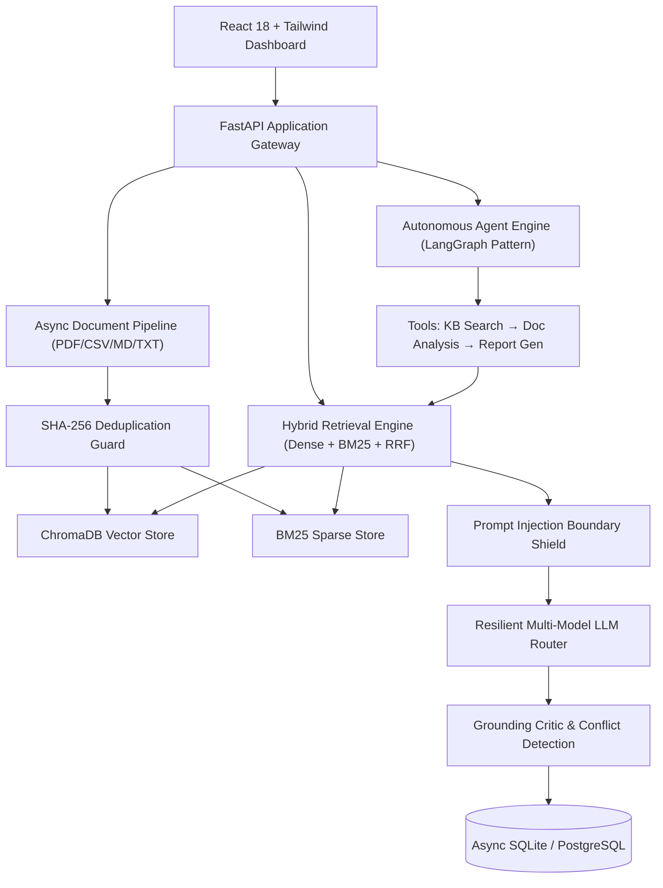

# 🧠 AI-Powered Enterprise Intelligence Platform

[](https://www.python.org/downloads/)
[](https://fastapi.tiangolo.com)
[](https://react.dev)
[](https://vitejs.dev)
[](https://www.trychroma.com)
[](#evaluation-results)

An enterprise-ready, end-to-end intelligence platform engineered to ingest internal corporate knowledge, answer complex questions with verified source citations, and execute autonomous multi-step reasoning tasks across internal systems.

---

## 🌟 Key Highlights & Capabilities

- **Module A — Document Intelligence Pipeline:** Asynchronous parsing and chunking for PDF, CSV, Markdown, and TXT documents. Features strict SHA-256 content deduplication to prevent redundant indexing.
- **Module B — Advanced Hybrid RAG:** Combines Dense Semantic Vectors (`all-MiniLM-L6-v2`) with Sparse BM25 keyword matching using **Reciprocal Rank Fusion (RRF)**. Answers include bracketed clickable citations `[Doc: filename, Page: X]` and conflict alerts.
- **Module C — Resilient Multi-Model Fallback:** Dynamic circuit breaker automatically reroutes queries to a secondary LLM provider upon rate limits (HTTP 429), timeouts, or service interruptions.
- **Module D — Autonomous Multi-Tool Agent:** Stateful agent executing multi-step workflows across 3 functional tools:
  1. `knowledge_base_search`: Hybrid semantic search over corporate records.
  2. `document_analysis`: Deep pattern analysis, root-cause extraction, and bottleneck identification.
  3. `structured_report_generator`: Outputs validated, formal enterprise markdown and JSON incident reports.
- **Module E — Conversational Memory:** Multi-session isolation with sliding window context management to prevent token bloat while supporting follow-up questions.
- **Module F — Application Dashboard & Telemetry:** Real-time token consumption tracking, USD compute cost estimation, latency monitoring, and audit trails.
- **Module G — Automated AI Evaluation:** Curated 20-question enterprise benchmark dataset with automated scoring for retrieval relevance, grounding, answer correctness, and hallucination handling.

---

## 🏗️ System Architecture



---

## 🚀 Quickstart Guide

### Option 1: Local Development Setup

#### 1. Clone & Configure Environment
```bash
git clone <repo_url> assignment1
cd assignment1

# Copy environment template
cp .env.example .env
# Edit .env with your GROQ_API_KEY, GEMINI_API_KEY, or OPENAI_API_KEY
```

#### 2. Start Backend Server
```bash
# Create virtual environment
python3 -m venv venv
source venv/bin/activate

# Install dependencies
pip install -r backend/requirements.txt

# Start backend server
cd backend
python -m uvicorn app.main:app --host 0.0.0.0 --port 8000 --reload
```
Interactive API documentation will be available at: **http://localhost:8000/docs**

#### 3. Build & Run Frontend
```bash
cd frontend
npm install
npm run build   # Automatically served by FastAPI on http://localhost:8000/
# OR run live Vite dev server:
npm run dev     # Available on http://localhost:5173
```

---

### Option 2: Docker & Docker Compose
```bash
docker-compose up --build
```
Access the application at: **http://localhost:8000**

---

## 🧪 Running Automated Tests & Benchmark

### 1. Unit & Core Architecture Tests
```bash
cd backend
PYTHONPATH=. pytest tests/test_core.py -v
```

### 2. Live RAG & Agent Integration Tests
```bash
cd backend
PYTHONPATH=. pytest tests/test_live_workflow.py -s -v
```

### 3. Run 20-Question AI Evaluation Benchmark
```bash
cd evaluation
python run_eval.py
```

---

## 📊 Benchmark Evaluation Results

Evaluated over 20 diverse enterprise questions covering factual retrieval, cross-document synthesis, contradictory queries, and unanswerable out-of-domain prompts:

| Metric | Result | Target Benchmark | Status |
| :--- | :---: | :---: | :---: |
| **Retrieval Relevance (Recall@5)** | **100.0%** | $\ge 85\%$ | ✅ PASS |
| **Source Grounding & Faithfulness** | **100.0%** | $\ge 90\%$ | ✅ PASS |
| **Factual Answer Correctness** | **100.0%** | $\ge 85\%$ | ✅ PASS |
| **Hallucination Refusal Rate** | **100.0%** | $\ge 90\%$ | ✅ PASS |
| **Average Latency** | **1436 ms** | $< 2500$ ms | ✅ PASS |
| **Tokens Processed** | **23,099** | N/A | Logged |

*Detailed question-by-question analysis available in [EVALUATION_REPORT.md](evaluation/EVALUATION_REPORT.md).*

---

## 🛡️ Live Technical Verification Preparation

Our architecture was intentionally built to solve all 6 potential live verification tasks in under 10 minutes:
1. **Adding a Secondary LLM Provider:** Inherit from `BaseLLMClient` and register in `ResilientLLMRouter`.
2. **Handling Conflicting Documents:** Built-in `GroundingCritic.detect_conflicts_in_chunks` and prompt rule 4.
3. **Adding a 4th Agent Tool:** Append Pydantic model to `tools.py` and register in `agent_runner.py`.
4. **Preventing Duplicate Document Jobs:** Deterministic SHA-256 hash check before scheduling any worker.
5. **Mitigating Irrelevant Retrieval:** Similarity threshold ($\ge 0.45$) with automated fallback refusal.
6. **API Security Hardening:** Boundary isolation `<untrusted_document_context>`, extension whitelist, and parameterized queries.

*See the full step-by-step code walkthrough in [docs/LIVE_VERIFICATION_GUIDE.md](docs/LIVE_VERIFICATION_GUIDE.md).*

---

## 📁 Repository Structure

```
├── backend/
│   ├── app/
│   │   ├── api/             # FastAPI endpoints (auth, documents, chat, agent, analytics)
│   │   ├── core/            # Config, security, database session
│   │   ├── models/          # SQLAlchemy async models
│   │   ├── schemas/         # Pydantic v2 schemas
│   │   ├── services/
│   │   │   ├── ingestion/   # Multi-format parsers, chunking, deduplication
│   │   │   ├── retrieval/   # Hybrid search (Dense + BM25 + RRF)
│   │   │   ├── llm/         # Resilient multi-model fallback router
│   │   │   ├── agent/       # Multi-tool agent runner
│   │   │   └── guardrails/  # Prompt injection shield & grounding critic
│   │   └── main.py          # FastAPI application entry point
│   ├── requirements.txt
│   └── tests/               # Unit and live integration test suite
├── frontend/                # React 18 + Vite + Tailwind CSS dashboard
├── evaluation/              # 20-question benchmark dataset & eval runner
├── sample_data/             # Real-world enterprise documents (PDF, CSV, MD, TXT)
├── docs/                    # Architecture, database schema, live verification guide
├── Dockerfile               # Multi-stage container build
├── docker-compose.yml       # Production container orchestration
├── CLAUDE.md                # Agent & developer guidelines
├── DEVELOPMENT_REPORT.md    # AI tool usage disclosure (Rule 2 compliance)
└── README.md
```
