# 🗄️ Database Schema & Storage Specifications

The platform employs a hybrid storage strategy:
1. **Relational Database (Async SQLite / PostgreSQL):** Manages user accounts, document metadata, processing status, multi-turn conversations, message history, citations, and telemetry audit logs.
2. **Vector Database (ChromaDB):** Persists dense 384-dimensional chunk embeddings indexed with HNSW cosine distance.
3. **Sparse Inverted Index (Pickle/BM25):** Persists tokenized corpus statistics for Okapi BM25 keyword retrieval.

---

## 1. Entity Relationship (ER) Diagram

```mermaid
erDiagram
    USERS ||--o{ DOCUMENTS : "uploads"
    USERS ||--o{ CONVERSATIONS : "owns"
    CONVERSATIONS ||--o{ MESSAGES : "contains"
    
    USERS {
        string id PK "UUID"
        string email UK "Indexed"
        string username UK "Indexed"
        string hashed_password
        string full_name
        boolean is_active
        boolean is_admin
        datetime created_at
    }

    DOCUMENTS {
        string id PK "UUID"
        string filename
        string file_path
        string file_type "pdf, txt, md, csv"
        int file_size_bytes
        string content_hash UK "SHA-256 Checksum"
        string status "PENDING, PROCESSING, INDEXED, FAILED"
        string error_message
        int chunk_count
        int character_count
        string uploader_id FK
        datetime created_at
        datetime updated_at
    }

    CONVERSATIONS {
        string id PK "UUID"
        string title
        string user_id FK
        text summary
        datetime created_at
        datetime updated_at
    }

    MESSAGES {
        string id PK "UUID"
        string conversation_id FK
        string role "user, assistant, system"
        text content
        json citations "List of [doc_id, page, excerpt]"
        json agent_trace "Tool steps, inputs, outputs"
        string model_used
        string provider_used
        int tokens_prompt
        int tokens_completion
        int latency_ms
        boolean is_fallback
        datetime created_at
    }

    TELEMETRY_LOGS {
        string id PK "UUID"
        string endpoint
        text query
        string provider
        string model
        int tokens_prompt
        int tokens_completion
        int total_tokens
        float estimated_cost_usd
        int latency_ms
        boolean fallback_triggered
        int status_code
        text error_message
        datetime created_at "Indexed"
    }
```

---

## 2. Table Definitions & Constraints

### `documents`
- `content_hash (VARCHAR(64), UNIQUE)`: Stores SHA-256 digest of file bytes. Guarantees idempotency and blocks duplicate document ingestion.
- `status (ENUM)`: State machine values: `PENDING` $\to$ `PROCESSING` $\to$ `INDEXED` (or `FAILED`).

### `telemetry_logs`
- Stores execution metrics for every `/api/chat/query` and `/api/agent/run` invocation.
- Indexed on `created_at` for high-speed aggregation of KPI statistics (P95 latency, total tokens, compute cost).

### ChromaDB Collection: `enterprise_knowledge_base`
- **Embedding Function:** `SentenceTransformer("all-MiniLM-L6-v2")` (384 dimensions).
- **Distance Metric:** Cosine distance ($HNSW$).
- **Metadata Stored:**
  - `document_id`: UUID of parent document
  - `document_name`: Original filename
  - `page_or_row`: Page number (PDF) or row number (CSV)
  - `chunk_index`: Sequence position
  - `char_count`: Character length of excerpt
